 

## 🍷 About Me

I'm a **Full Stack Developer** from New Delhi with **2 years of experience** building and deploying web applications on the **MERN stack**.

I enjoy the space where web apps meet AI: **RAG pipelines, vector search and agentic workflows** with the OpenAI API and n8n, wrapped in secure REST APIs with JWT, OTP and role-based access.

Right now I'm a **Software Developer (Full Stack) at Thermal Engineers & Insulators Pvt. Ltd.**, digitizing internal operations and automating business workflows.

 

## 🎓 Education & Experience

| | Where | When |
|---|---|---|
| 💼 **Software Developer (Full Stack)** | Thermal Engineers & Insulators Pvt. Ltd. | Sep 2025 – Present |
| 💼 **Frontend Developer** | India IPO | Oct 2024 – Aug 2025 |
| 🎓 **Master of Computer Applications (MCA)** | IGNOU | 2023 – 2025 |
| 🎓 **Bachelor of Computer Applications (BCA)** · 92.20% | GGS Indraprastha University | 2020 – 2023 |

## 🚀 Selected Projects

<table>
<tr>
<td width="50%" valign="top">

### 📜 Contract Mitra
**Problem:** reviewing contracts by hand is slow and easy to get wrong. 
**Built:** a contract management platform with AI clause analysis (OpenAI API), semantic search over contracts (Qdrant) and Supabase auth with real-time sync behind an Express REST layer.

`React.js` `Node.js` `Express.js` `Supabase` `OpenAI API` `Qdrant`

</td>
<td width="50%" valign="top">

### 🏥 Hospital VIP Web App
**Problem:** VIP patient data needs tight, role-based access. 
**Built:** a secure hospital app with OTP login, role-based access control, real-time patient records and appointment management.

`React.js` `Node.js` `Express.js` `Supabase` `RBAC`

</td>
</tr>
<tr>
<td colspan="2" valign="top">

### 🎮 [Tic-Tac-Toe](https://github.com/Priyamalhotra08/tic-tac-toe)
A two-player game with reset and new-game options and a dynamic view. `JavaScript` `HTML` `CSS`

</td>
</tr>
</table>

## 🛠️ Skills

| Category | Stack |
|---|---|
| **Frontend** |    Responsive design · Lazy loading · Code splitting |
| **Backend** |    REST APIs · JWT & OTP auth · RBAC · System design |
| **Databases** |    MongoDB · PostgreSQL (Supabase) · Qdrant (vector DB) |
| **AI & Automation** | OpenAI API · RAG pipelines · Agentic AI · n8n · Web scraping |
| **DevOps & Tools** |    Docker · Kubernetes · GitHub Actions · CI/CD |

## 🌱 Contribution Activity

Live from my real GitHub contributions · refreshed daily by GitHub Actions

  

## 🤝 Let's Connect

[LinkedIn](https://linkedin.com/in/priyamalhotra08) · [Email](mailto:priya0808malhotra@gmail.com) · [GitHub](https://github.com/Priyamalhotra08)

 

