<div align="center">


<br/>



<br/><br/>

<a href="https://linkedin.com/in/priyamalhotra08"></a>
<a href="mailto:priya0808malhotra@gmail.com"></a>


</div>

## 💗 About Me

```js
const priya = {
  role:       "Full Stack Developer (MERN)",
  location:   "New Delhi, India 🇮🇳",
  experience: "2 years",
  now:        "Software Developer @ Thermal Engineers & Insulators",
  loves:      ["RAG pipelines", "Agentic AI", "n8n automation", "clean APIs"],
  shipsWith:  ["Docker", "Kubernetes", "GitHub Actions"],
  education:  "MCA (IGNOU) · BCA (GGSIPU, 92.2%)",
};
```

- 🔭 Building full stack apps that **digitize real business workflows**
- 🤖 Working with **RAG, OpenAI API, Qdrant vector search and n8n agents**
- 🔐 Designing secure REST APIs with **JWT, OTP and role-based access**
- 🚀 Shipping with **CI/CD, Docker and Kubernetes**

## 🛠️ Tech Stack

<div align="center">


<br/>

<br/><br/>


</div>

## 💼 Experience

| Role | Company | When |
|---|---|---|
| 💻 **Software Developer (Full Stack)** | Thermal Engineers & Insulators Pvt. Ltd. | Sep 2025 – Present |
| 🎨 **Frontend Developer** | India IPO | Oct 2024 – Aug 2025 |

## 🚀 Featured Projects

<table>
<tr>
<td width="50%" valign="top">

### 📜 Contract Mitra
AI-powered contract management with clause analysis (OpenAI) and semantic search over contracts (Qdrant), Supabase auth and real-time sync.

`React` `Node` `Express` `Supabase` `OpenAI` `Qdrant`

</td>
<td width="50%" valign="top">

### 🏥 Hospital VIP Web App
Secure hospital app for VIP patients with OTP login, role-based access, real-time patient records and appointments.

`React` `Node` `Express` `Supabase` `RBAC`

</td>
</tr>
</table>

## 📊 GitHub Stats

<div align="center">


<br/>


</div>


